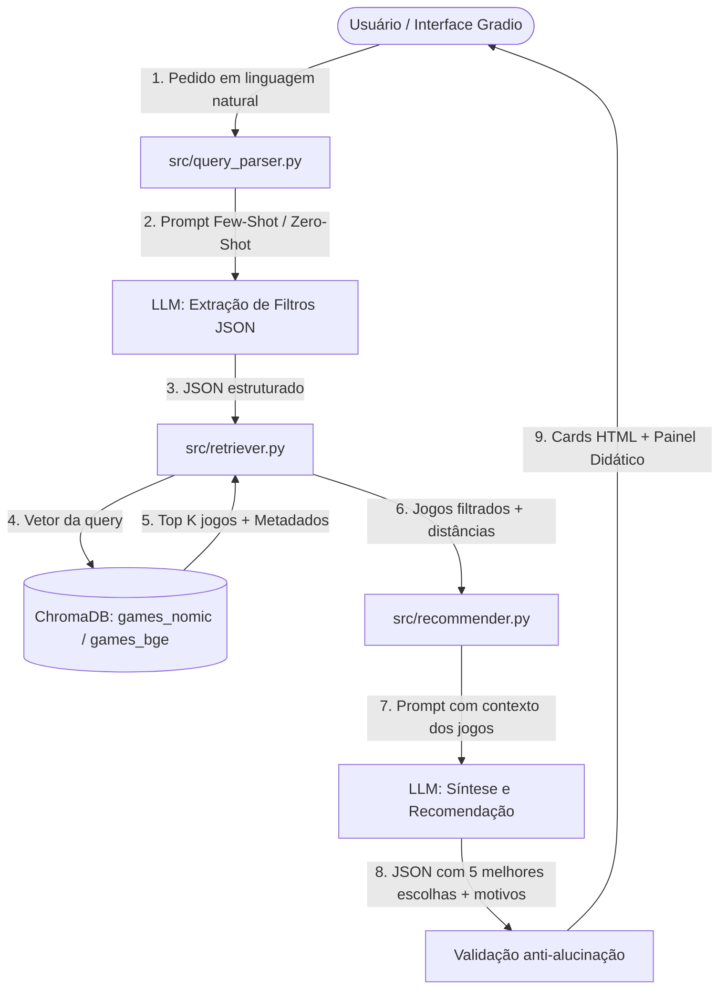

# GameFinder RAG

Recomendador de jogos da Steam a partir de pedidos em linguagem natural, utilizando LLMs e RAG (Retrieval-Augmented Generation) com busca semântica sobre dataset público da Steam.

Projeto desenvolvido para a disciplina **TEIA (1ª Unidade) - IFPE**.

## Objetivos do Projeto

- **Busca Semântica:** Permitir que o usuário faça pedidos em linguagem natural (ex.: "jogo cooperativo curto e relaxante para jogar com amigos, até R$ 50").
- **Extração de Filtros com LLM:** Identificar preço máximo, plataformas (Windows, Mac, Linux), modos (coop, multiplayer) e ano de lançamento.
- **RAG com ChromaDB:** Recuperação vetorial de jogos no banco vetorial utilizando embeddings (`nomic-embed-text` e `bge-m3`).
- **Prevenção de Alucinação:** LLM recomenda e justifica apenas os jogos recuperados no contexto, com validação cruzada de `app_id`.
- **Interface Interativa (Gradio):** Demonstração didática dos conceitos de tokenização, embeddings, espaço vetorial (mapa UMAP 2D), temperatura e comparação Com RAG vs Sem RAG.

## Arquitetura Técnica



## Estrutura do Projeto

```text
TEIA/
├── app.py                 # Interface Gradio (ponto de entrada)
├── requirements.txt       # Dependências do projeto
├── .env.example           # Modelo de configuração de ambiente
├── .gitignore
├── README.md
├── data/
│   ├── raw/               # CSV original do dataset (ignorado no git)
│   ├── processed/         # games.parquet limpo e caches UMAP
│   └── chroma/            # Banco vetorial ChromaDB (ignorado no git)
├── src/
│   ├── config.py          # Configurações centralizadas (.env)
│   ├── data_prep.py       # Limpeza e preparação do dataset
│   ├── indexer.py         # Geração de embeddings e indexação
│   ├── tokens.py          # Contagem e inspeção de tokens
│   ├── llm.py             # Cliente de LLM unificado (Ollama)
│   ├── query_parser.py    # Extração de filtros via LLM (Few-Shot/Zero-Shot)
│   ├── retriever.py       # Busca vetorial + filtros + relaxamento
│   ├── recommender.py     # Pipeline RAG completo com validação
│   ├── similar.py         # Jogos parecidos com X
│   ├── viz.py             # Projeção UMAP 2D com Plotly
│   └── prompts/           # Prompts versionados (.txt)
├── eval/
│   ├── queries.json       # Pedidos de teste com jogos esperados
│   ├── evaluate.py        # Benchmark hit@5: Sem RAG vs RAG
│   └── results.md         # Tabela de resultados
├── scripts/
│   ├── download_dataset.py # Download do dataset
│   ├── inspect_data.py     # Inspeção inicial do dataset
│   └── smoke_test.py       # Teste rápido do LLM e embeddings
└── docs/
    └── planejamento_fases_5_a_9.md
```

## Mapeamento Didático do Edital

| Conteúdo Curricular | Onde é Abordado | Arquivo/Local |
|---------------------|-----------------|---------------|
| **Tokenização (BPE)** | Visualização interativa de tokens com `cl100k_base`, contagem e truncamento | `src/tokens.py`, Aba "Como Funciona" |
| **Embeddings** | Geração com `nomic-embed-text` e `bge-m3`, comparação de similaridade de cosseno | `src/llm.py`, `src/indexer.py`, Aba "Como Funciona" |
| **Espaço Vetorial** | Mapa 2D com UMAP, agrupamentos semânticos, visualização interativa | `src/viz.py`, Aba "Mapa Vetorial 2D" |
| **Mecanismo de Atenção/Transformer** | Explicação didática na interface | Aba "Como Funciona" |
| **Engenharia de Prompt (Few-Shot/Zero-Shot)** | Extração de filtros com exemplos, comparação few-shot vs zero-shot | `src/prompts/parse_query.txt`, `src/prompts/parse_query_zeroshot.txt`, `src/query_parser.py` |
| **RAG (Retrieval-Augmented Generation)** | Pipeline completo com recuperação vetorial, contexto, validação anti-alucinação | `src/retriever.py`, `src/recommender.py`, `src/prompts/recommend.txt` |

## Como Executar

### 1. Pré-requisitos
- **Python 3.10 a 3.12**
- **Ollama** ([ollama.com](https://ollama.com)) instalado com os modelos:
```bash
ollama pull qwen2.5:7b
ollama pull nomic-embed-text
ollama pull bge-m3
```

### 2. Configuração do Ambiente
```bash
# Clone o repositório
git clone https://github.com/viniscastro/TEIA.git
cd TEIA

# Crie e ative o ambiente virtual
python -m venv .venv
# No Windows:
.\.venv\Scripts\activate
# No Linux/Mac:
source .venv/bin/activate

# Instale as dependências
pip install -r requirements.txt

# Configure as variáveis de ambiente
cp .env.example .env
```

### 3. Preparação dos Dados e Indexação
```bash
# (Opcional) Baixar dataset bruto
python scripts/download_dataset.py

# Preparar dataset limpo (gera data/processed/games.parquet)
python src/data_prep.py

# Gerar embeddings e indexar no ChromaDB
python src/indexer.py

# Gerar mapa vetorial UMAP (opcional, mas recomendado)
python src/viz.py --collection all --max-samples 3000
```

### 4. Executar a Aplicação
```bash
# Iniciar interface Gradio
python app.py
```
Acesse: [http://localhost:7860](http://localhost:7860)

### 5. Avaliação (Opcional)
```bash
# Executar benchmark automatizado
python eval/evaluate.py
```
Os resultados serão salvos em `eval/results.md`.

## Funcionalidades da Interface

A interface possui 4 abas principais:

1. **Recomendar** - Digite seu pedido em linguagem natural, veja filtros extraídos, candidatos recuperados, métricas (tokens/tempo) e recomendações validadas com links para Steam. Suporte a modo com/sem RAG.
2. **Parecidos com...** - Selecione um jogo e encontre os 8 mais similares vetorialmente.
3. **Como Funciona** - Painel didático com tokenizador interativo, comparador de embeddings, teste de temperatura e explicações sobre os conceitos.
4. **Mapa Vetorial 2D** - Visualização interativa UMAP com pontos coloridos por gênero, tooltips e possibilidade de visualizar agrupamentos semânticos.

## Tecnologias Utilizadas

- **LLM/Embeddings:** Ollama (qwen2.5:7b, nomic-embed-text, bge-m3)
- **Vector DB:** ChromaDB
- **Framework Web:** Gradio
- **Visualização:** Plotly, UMAP
- **Processamento:** pandas, numpy, scikit-learn
- **Tokenização:** tiktoken (cl100k_base)

## Limitações e Próximos Passos

- **Indexação completa:** As coleções precisam estar totalmente indexadas para melhor cobertura
- **Avaliação:** Os `expected_app_ids` no `eval/queries.json` são exemplos e podem precisar de ajuste conforme o dataset real
- **Provedores alternativos:** Suporte a NVIDIA/HuggingFace está estruturado mas não totalmente implementado
- **Destaque dinâmico no mapa:** Funcionalidade preparada para evolução futura

## Autores
- [Jefferson Felipe](https://github.com/isjustjefferson)
- [Vinícius Castro](https://github.com/vinicastro) 
