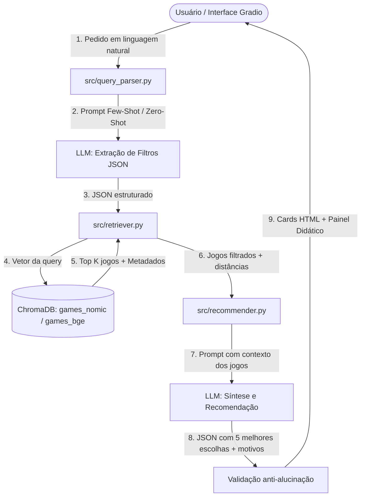

# Planejamento Detalhado: Fases 5 a 9 - GameFinder RAG 🎮
**Disciplina:** TEIA (1ª Unidade) - IFPE  
**Projeto:** Recomendador de Jogos da Steam com RAG e Busca Semântica

---

## 🏛️ Visão Geral da Arquitetura do Sistema



---

## 🔹 FASE 5: Engenharia de Prompt (Pedido $\rightarrow$ Filtros JSON)

### 🎯 Objetivo
Transformar pedidos livres e informais em linguagem natural (ex: *"quero um rpg de ação cooperativo até 50 conto pra jogar com 2 amigos no windows"*) em uma estrutura de dados estrita em JSON com filtros relacionais e busca semântica refinada.

### 📁 Arquivos a Criar
1. `src/prompts/parse_query.txt` (Prompt principal com System Message e Few-Shot)
2. `src/prompts/parse_query_zeroshot.txt` (Versão Zero-Shot para comparação didática)
3. `src/query_parser.py` (Lógica de chamada, validação Pydantic, retry e fallback)

### 📐 Schema do JSON de Saída
```json
{
  "busca_semantica": "rpg de ação fantasia aventura",
  "preco_max": 50.0,
  "plataforma": "windows",
  "multiplayer": true,
  "coop": true,
  "ano_min": null
}
```

### 🧠 Engenharia de Prompt (Few-Shot vs Zero-Shot)
- **Few-Shot (`parse_query.txt`):**
  - Contém instruções claras do papel do assistente.
  - 4 exemplos calibrados:
    1. Pedido completo com preço, modo e gênero.
    2. Pedido informal/gírias (ex: *"jogo levinho de tiro pra jogar com a rapaziada sem gastar nada"* $\rightarrow$ `preco_max: 0.0`, `coop: true`, `busca_semantica: "tiro multijogador"`).
    3. Pedido puramente conceitual sem restrições numéricas (ex: *"jogo relaxante de fazenda com música bonita"* $\rightarrow$ filtros nulos, mantendo apenas `busca_semantica`).
    4. Pedido com restrição de plataforma (ex: *"souls-like desafiador no linux"* $\rightarrow$ `plataforma: "linux"`).
- **Zero-Shot (`parse_query_zeroshot.txt`):** Apenas descreve o esquema esperado sem fornecer exemplos, permitindo comparar nos slides como o *few-shot* reduz drasticamente falhas de formatação.

### 🛡️ Tratamento de Erros e Resiliência
1. Chamada ao Ollama configurada com `temperature=0.0` e `json_mode=True`.
2. Validação estrita via modelo **Pydantic**:
   - Tipos e valores permitidos (`plataforma in ['windows', 'mac', 'linux', None]`).
3. **Mecanismo de Retry & Fallback:**
   - Se o JSON vier truncado ou inválido: realiza **1 tentativa adicional** pedindo correção.
   - Se falhar novamente: aplica o fallback seguro, utilizando o texto integral do usuário como `busca_semantica` com todos os filtros zerados.

---

## 🔹 FASE 6: RAG Completo (Recuperação + Recomendação)

### 🎯 Objetivo
Recuperar os jogos mais similares no banco vetorial respeitando os filtros e instruir o LLM a atuar como especialista em curadoria de jogos, recomendando os 5 melhores **estritamente a partir dos documentos recuperados**, eliminando qualquer invenção.

### 📁 Arquivos a Criar
1. `src/retriever.py` (Busca vetorial combinada com cláusulas `where` do ChromaDB)
2. `src/recommender.py` (Pipeline de recomendação, contagem de tokens, medição de latência)
3. `src/prompts/recommend.txt` (Prompt do especialista com diretrizes anti-alucinação)

### 🔍 Lógica do Retriever (`src/retriever.py`)
- Executa a busca vetorial usando o embedding da `busca_semantica`.
- Monta a cláusula de filtro booleana/numérica do ChromaDB:
  ```python
  where = {"$and": [{"price": {"$lte": preco_max}}, {"windows": True}, {"coop": True}]}
  ```
- **Relaxamento Automático de Filtros:** Se a combinação de filtros for excessivamente restritiva e retornar 0 jogos, o retriever relaxa progressivamente os filtros secundários (como ano ou plataforma) e emite um alerta informativo ao usuário.

### 🤖 Lógica do Recommender (`src/recommender.py`)
1. **Montagem do Contexto:** Formata os $K=20$ jogos candidatos com índice, nome, preço, tags, reviews e resumo.
2. **Medição de Tokens e Tempo:**
   - Conta os tokens do contexto enviado usando `src/tokens.py`.
   - Mede o tempo exato de cada etapa (parser, recuperação vetorial e geração final).
3. **Prompt Anti-Alucinação (`recommend.txt`):**
   - Instrução mandatória: *"Selecione até 5 jogos exclusivamente da lista numerada abaixo. É estritamente proibido inventar nomes, preços ou mecânicas que não estejam no contexto."*
   - Retorno em JSON: `[{"app_id": 413150, "motivo": "Combina perfeitamente com seu pedido por ser focado em agricultura..."}]`
4. **Validação Cruzada de AppIDs:**
   - O código verifica se cada `app_id` retornado pelo LLM pertence aos jogos recuperados. Caso o LLM invente um ID inexistente, ele é descartado e um alerta de log é registrado.
5. **Modo Didático `use_rag=False`:**
   - Faz a mesma pergunta diretamente ao LLM sem fornecer nenhum contexto vetorial. Ideal para mostrar nos slides a tendência de modelos sem RAG alucinarem preços desatualizados ou inventarem títulos inexistentes.

---

## 🔹 FASE 7: Interface Web Gradio

### 🎯 Objetivo
Construir uma interface visual moderna, responsiva e didática em Gradio Blocks com tema escuro, expondo todos os conceitos exigidos pelo edital.

### 📁 Arquivos a Criar / Atualizar
1. `src/similar.py` (Função para buscar os 8 jogos mais parecidos por ID de jogo)
2. `app.py` (Ponto de entrada da aplicação web com 4 abas)

### 🖥️ Estrutura das 4 Abas

#### Aba 1: 🎮 Recomendar
- **Entrada:** Caixa de texto para o pedido do usuário + Botão "Buscar Recomendações".
- **Accordion de Opções Avançadas:**
  - Preço máximo (slider).
  - Plataforma (Dropdown: Todas, Windows, Mac, Linux).
  - Modelo de Embedding (Toggle: A = `nomic-embed-text`, B = `bge-m3`).
  - Temperatura do LLM (Slider de 0.0 a 1.5).
  - Checkbox *"Usar RAG"* (para demonstrar a diferença entre ter ou não ter contexto).
- **Saída:**
  - Grid de **Cards HTML estilizados** com: Nome, Preço formatado, Tags visuais, Justificativa do LLM e Botão direto com link para a Steam (`https://store.steampowered.com/app/<app_id>`).
- **Accordion Técnico ("Por baixo dos panos"):**
  - Exibe o JSON de filtros extraído.
  - Lista completa dos jogos recuperados no ChromaDB com suas respectivas distâncias de cosseno.
  - Contagem de tokens consumidos no prompt.
  - Tempo de execução detalhado (Etapa 1: Parser | Etapa 2: Recuperação | Etapa 3: Síntese).

#### Aba 2: 🔗 Parecidos com...
- Dropdown pesquisável com autocompletar contendo os jogos da Steam.
- Ao selecionar um jogo (ex: *Hollow Knight*), recupera imediatamente pelo ChromaDB os **8 jogos mais próximos vetorialmente** utilizando o embedding, exibindo cards com distância e afinidade.

#### Aba 3: 💡 Como Funciona (Painel Didático)
- **Tokenizador Interativo:** Campo de digitação onde o usuário vê em tempo real o texto fatiado em tokens coloridos e seus respectivos IDs numéricos (`cl100k_base`).
- **Comparador de Embeddings:** Dois campos de texto onde o usuário digita frases e o sistema calcula a **Similaridade de Cosseno** nos modelos A e B simultaneamente.
- **Efeito da Temperatura:** Gera a resposta do mesmo pedido lado a lado com `temperatura = 0.0` (determinística) e `temperatura = 1.2` (criativa/aleatória).
- **Conteúdo Didático:** Bloco explicativo em Markdown detalhando a arquitetura Transformer, mecanismo de Auto-Atenção e amostragem de probabilidades (*Softmax*).

#### Aba 4: 🗺️ Mapa Vetorial 2D
- Conecta diretamente à projeção visual da Fase 8.

---

## 🔹 FASE 8: Mapa 2D dos Jogos (UMAP & Plotly)

### 🎯 Objetivo
Projetar o espaço multidimensional de embeddings (768d / 1024d) em um plano bidimensional interativo (2D) utilizando UMAP, tornando visível como a inteligência artificial agrupa jogos por gênero e estilo.

### 📁 Arquivos a Criar
1. `src/viz.py` (Redução de dimensionalidade com UMAP, cache em Parquet e renderização Plotly)

### 🔬 Metodologia e Otimização
- **Amostragem Eficiente:** Seleciona até 3.000 jogos das coleções para garantir renderização fluida no navegador.
- **Redução com UMAP:** Parâmetros calibrados (`n_neighbors=15`, `min_dist=0.1`, `metric='cosine'`, `random_state=42` para reprodutibilidade).
- **Cache de Coordenadas:** Salva as coordenadas calculadas em `data/processed/umap_games_nomic.parquet` e `data/processed/umap_games_bge.parquet`. Na inicialização do app, o cálculo não é refeito, carregando instantaneamente.
- **Gráfico Interativo com Plotly:**
  - Pontos coloridos de acordo com o **gênero principal** do jogo.
  - Tooltip (hover) exibindo: Nome do jogo, Preço, Tags e Avaliações.
  - **Destaque Dinâmico:** Função que realça no gráfico os 5 jogos recomendados na última busca do usuário, permitindo ver onde eles se situam no universo da Steam.

---

## 🔹 FASE 9: Avaliação e README

### 🎯 Objetivo
Produzir uma bateria de testes padronizada para mensurar quantitativamente a precisão do sistema e documentar o projeto de acordo com todos os requisitos do edital da 1ª Unidade de TEIA.

### 📁 Arquivos a Criar
1. `eval/queries.json` (20 pedidos de teste representativos com lista de jogos esperados)
2. `eval/evaluate.py` (Script de benchmark automatizado calculando métricas)
3. `eval/results.md` (Tabela comparativa gerada automaticamente)
4. `README.md` (Documentação completa do repositório)

### 📊 Métrica e Configurações de Benchmark
O script `eval/evaluate.py` executará as 20 queries em **3 configurações distintas**:
1. **Configuração A:** LLM Puro (Sem RAG)
2. **Configuração B:** RAG com Embedding A (`nomic-embed-text`)
3. **Configuração C:** RAG com Embedding B (`bge-m3`)

#### Métricas Calculadas:
- **Hit@5:** Percentual de vezes em que pelo menos um jogo esperado apareceu entre os top 5 recomendados.
- **Taxa de Alucinação:** Quantidade de jogos ou IDs inventados que não existem no catálogo.
- **Tempo Médio de Resposta (Latência):** Em segundos.

### 📄 Estrutura do README Final
- **Descrição do Problema e Solução:** Por que a busca por palavras-chave tradicional da Steam falha e como o RAG resolve.
- **Demonstração:** Screenshots das abas do aplicativo e do mapa 2D.
- **Arquitetura Técnica:** Diagrama em Mermaid com o fluxo completo de dados.
- **Mapeamento Didático do Edital:** Tabela indicando exatamente onde cada conteúdo curricular aparece (Tokenização, Embeddings, Mecanismo de Atenção/Transformer, Engenharia de Prompt Few-Shot/Zero-Shot e RAG).
- **Instruções de Instalação e Execução:** Comandos reproduzíveis para clonar, configurar o ambiente virtual, modelos Ollama e iniciar o Gradio.
- **Resultados e Limitações:** Análise comparativa dos resultados da avaliação e próximos passos.
